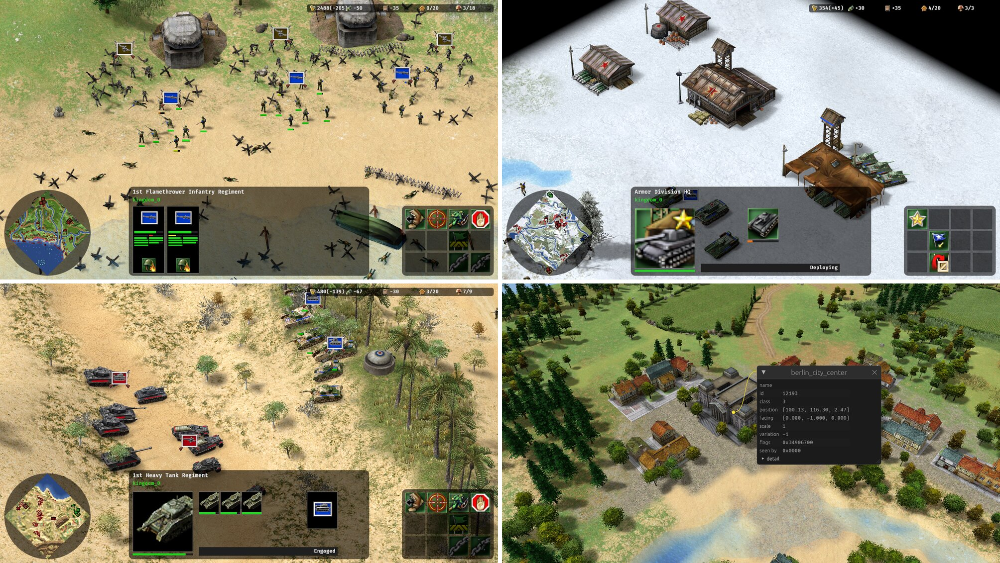

Tools for working with the data files of [Axis & Allies (2004)](https://en.wikipedia.org/wiki/Axis_%26_Allies_(2004_video_game)), the
real-time strategy game.

You need your own copy of the game. This project contains no game code or data.

## Crates

| Crate | What it does | Status |
|---|---|---|
| [`tgck`](crates/tgck) | Reads the game's `.rwd` archives and `.rmp` maps, as a library and a command-line tool | Done; a few map fields still unnamed |
| [`tgi`](crates/tgi) | Parses the game's `.tgi` text data files (units, templates, settings, localisation) | Done |
| [`nif`](crates/nif) | Reads the game's `.nif` models, as a library and a command-line tool | Done; particle systems skipped |
| [`aaa‑data`](crates/data) | The game's data as a whole: archive lookup and definitions built from its files, as a library and a command-line tool | Partial: definitions cover what rendering needs |
| [`aaa‑map`](crates/map) | Maps as loaded: the ground, objects and players | Early: ground, placed objects, players and teams, regiments and where movers can go |
| [`aaa‑sim`](crates/sim) | The game's rules, played out with no rendering | Early: sides and how they stand toward each other; regiments take their owner's orders and move in formation around what blocks them |
| [`aaa‑render`](crates/render) | Draws maps with Bevy | Ground, water, models and their animations, units idling and walking; no particles |
| [`aaa‑editor`](crates/editor) | Map editor built with Bevy | Views maps; no editing yet |
| [`aaa‑game`](crates/game) | Plays matches on a map picked from a menu | Play one side: select your regiments, send them somewhere and change their formation; no combat yet |

## Building

```sh
cargo build --release
cargo test
```

Requires Rust 1.88 or newer (1.97.1 for the Bevy crates). The `tgck`, `tgi`, `nif`, `aaa-data`, `aaa-editor` and `aaa-game` commands end up
in `target/release/`. The editor has extra system requirements on Linux; see
[its README](crates/editor/README.md).

## Legal

Not affiliated with or endorsed by TimeGate Studios, Atari or Hasbro. Axis &
Allies is a trademark of Hasbro, used here only to describe which game's files
these tools read.

Licensed under the [MIT license](LICENSE).
