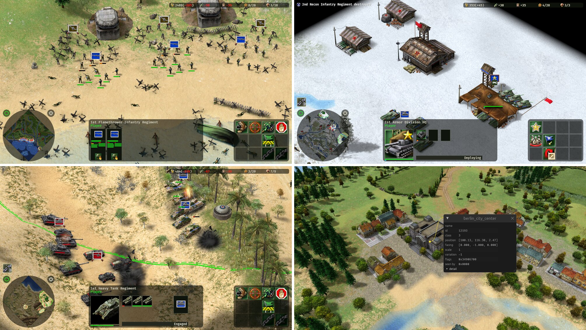

[](https://github.com/rowanseymour/aaa/actions/workflows/ci.yml)
[](LICENSE)

An open source re-implementation of [Axis & Allies (2004)](https://en.wikipedia.org/wiki/Axis_%26_Allies_(2004_video_game)),
the real-time strategy game, written in [Rust](https://rust-lang.org) with [Bevy](https://bevy.org).
It's a work in progress, playable in parts. Name is pronounced _aaaaahh_.

> [!IMPORTANT]
> You need your own copy of the game. This project contains no game code or data.

> [!NOTE]
> This is not a decompilation of the game: the code is written from scratch, clean-room style.
> The original game's behavior is written up as specs, and the code here is written only from
> those specs, the data files and the game itself, played.

## Goals

- Play the original game on modern systems, Linux and macOS included, from its own data files.
- Play like the original: the same rules giving the same results.
- Stay driven by the data files, so the maps and mods made for the original keep working.
- Make the game easier to mod, starting with a map editor and documented
  [file formats](docs/formats).

## Status

Matches play on the original maps against an idle opponent. You can't win or lose yet.



| Feature | Status |
|---|---|
| Data files, maps and models | ✅ Read in full |
| Drawing the game | ✅ Ground, units, animations, effects, the game's own interface |
| Movement and combat | 🟡 Regiments move, fight and take buildings and cities |
| Economy and supply | 🟡 Income, upkeep, supply and HQs; nothing to build or buy yet |
| Map editor | 🟡 Views maps; no editing yet |
| AI, multiplayer, saves, campaigns | ⬜ Not started |

## Running

You need Rust, and on Linux the system packages listed in the
[editor's README](crates/editor/README.md). `aaa.sh` builds and runs the game or the
map editor, given the folder your copy of the game is installed in:

```sh
./aaa.sh --data="/path/to/Axis and Allies"
./aaa.sh editor --data="/path/to/Axis and Allies"
```

Set `AAA_INSTALL` to that folder to leave `--data` off. Run `./aaa.sh --help` for
usage.

## Development

The code is a workspace of crates in [`crates/`](crates), from readers for the game's
file formats up to the game itself.

```sh
cargo build --release
cargo test
```

## Contributing

Bug reports, ideas and pull requests are welcome. For anything large, open an
issue first so we can talk it through.

Because of the clean-room approach above, contributions must come from how the game
behaves, never from its code: nothing taken from disassembling or decompiling it, and
nothing that mirrors its structure. Playing the game and reading its data files is
fair game.

## Legal

Not affiliated with or endorsed by TimeGate Studios, Atari or Hasbro. Axis &
Allies is a trademark of Hasbro, used here only to describe which game's files
these tools read.

Copyright © 2026 Rowan Seymour. Licensed under the [GNU GPL v3 or later](LICENSE).
