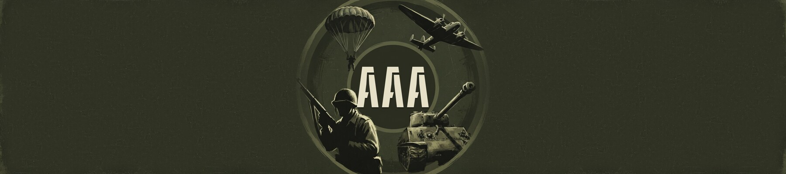
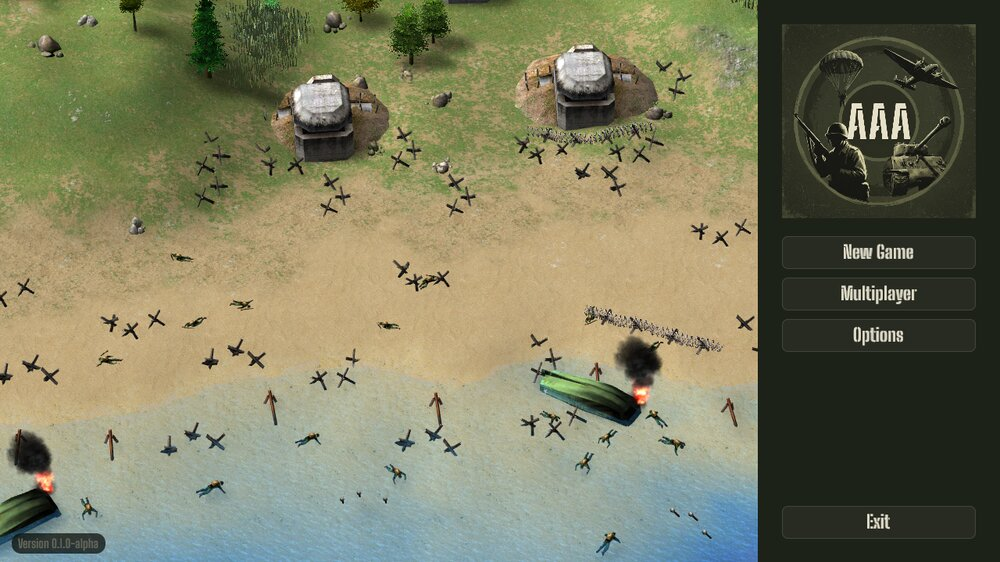
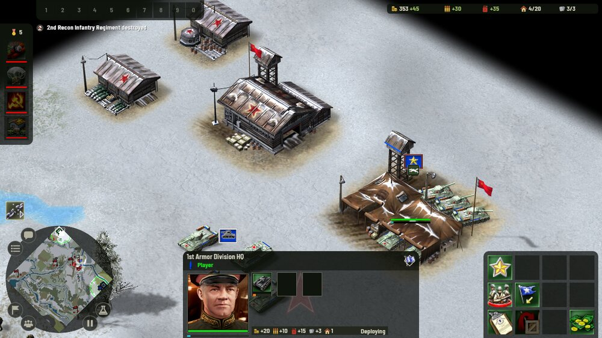
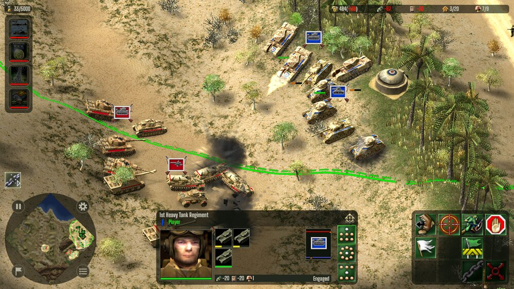
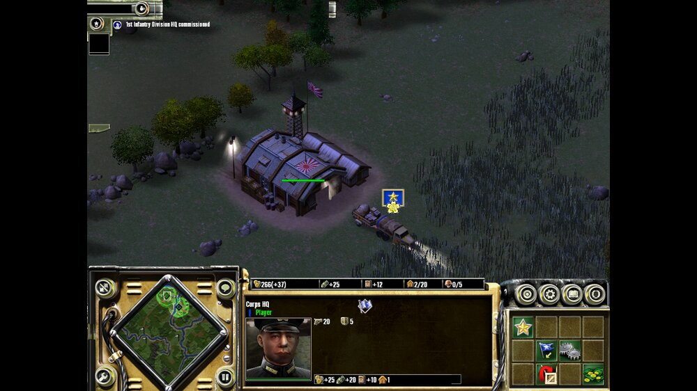
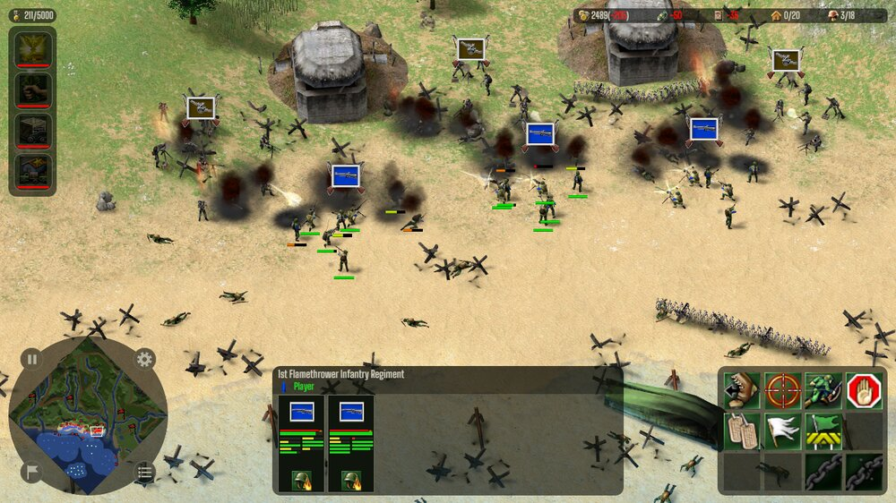
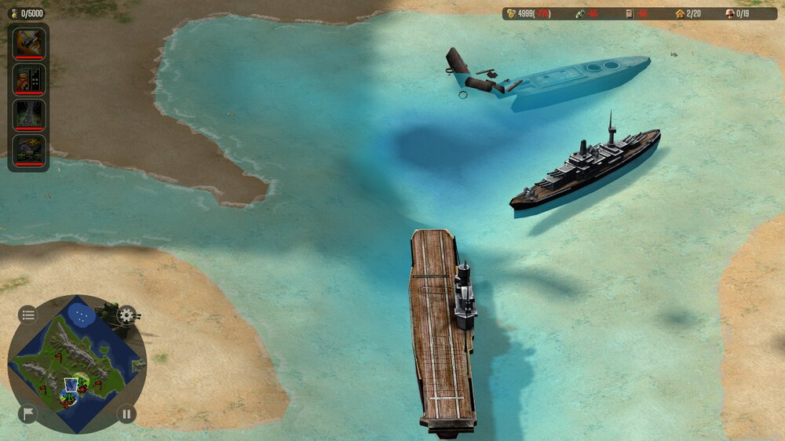
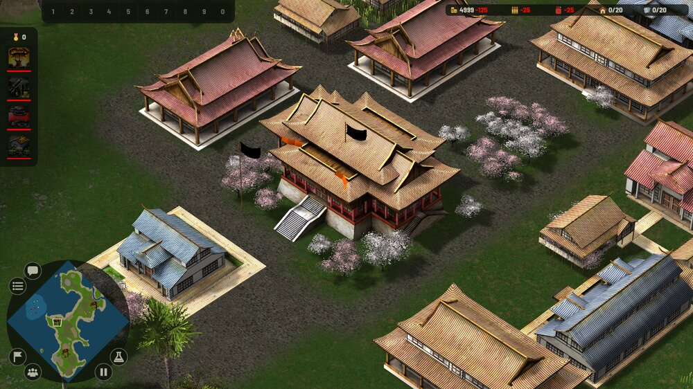
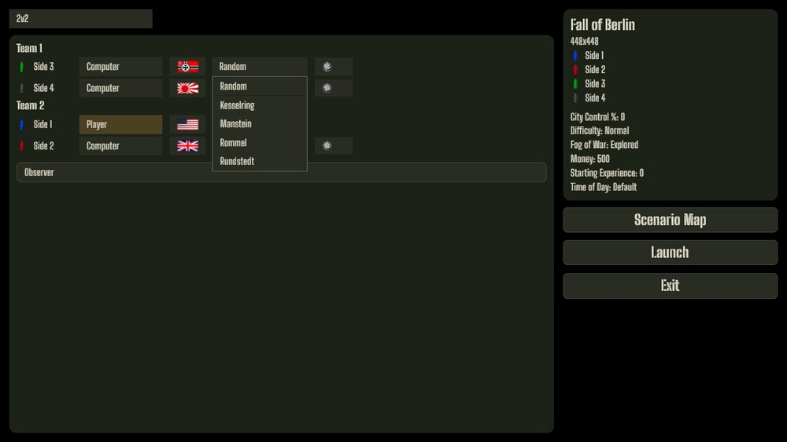
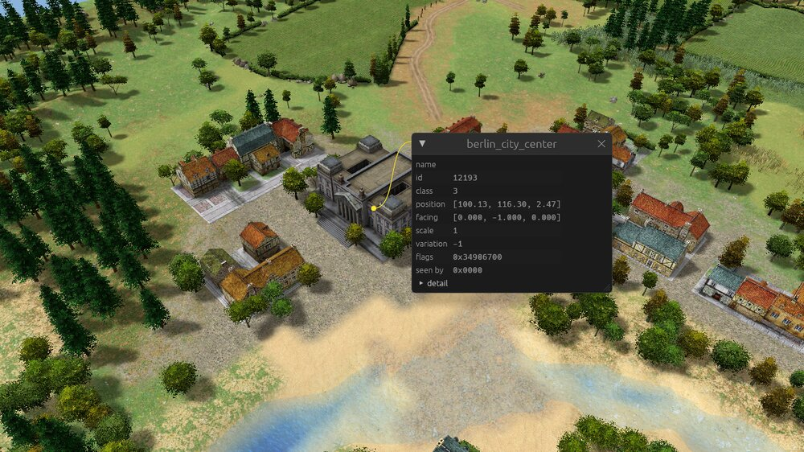

[](https://github.com/rowanseymour/aaa/actions/workflows/ci.yml)
[](LICENSE)
[](https://bevy.org)

An open source reimplementation of the real-time strategy game [Axis & Allies (2004)](https://en.wikipedia.org/wiki/Axis_%26_Allies_(2004_video_game)), 
and the underlying engine used for that game and [Kohan II](https://en.wikipedia.org/wiki/Kohan_II:_Kings_of_War). 
It's written in [Rust](https://rust-lang.org) with [Bevy](https://bevy.org). Name is pronounced _aaaaahh_.

> [!IMPORTANT]
> You need your own copy of the original game. This project contains none of its code or data.

> [!NOTE]
> This is a clean-room reimplementation rather than a recompilation: it reproduces the
> original game's behavior, not its code. That behavior is written up as specs, and the code
> here is written from those specs, the data files and the game itself, played.

<p>
<a href="docs/screenshots/main-menu.jpg"></a>
<a href="docs/screenshots/stalingrad.jpg"></a>
<a href="docs/screenshots/el-alamein.jpg"></a>
<a href="docs/screenshots/berlin.jpg"></a>
<a href="docs/screenshots/normandy.jpg"></a>
<a href="docs/screenshots/pearl-harbor.jpg"></a>
<a href="docs/screenshots/okinawa.jpg"></a>
<a href="docs/screenshots/lobby.jpg"></a>
<a href="docs/screenshots/berlin-editor.jpg"></a>
</p>

## Goals

- Plays like the original: the same rules giving the same results. Anywhere it looks or
  controls differently on purpose, that's listed in [divergences](docs/divergences.md).
- Playable on macOS, Linux and Windows.
- Stay driven by the data files so the original's maps and mods keep working, and new ones are easier to make.
- Great documentation of everything including [file formats](docs/formats).

## Status

| Feature | Status |
|---------------------|---------|
| Data files          | ✅ Maps and models read in full |
| Rendering           | ✅ Ground, units, animations, effects |
| UI                  | 🟡 Menus, lobby and in-match interface for custom games, and basic options |
| Movement and combat | ✅ Regiments move, fight, rout and take buildings and cities |
| Economy and supply  | 🟡 Income, upkeep, supply, building, recruiting and research |
| Campaign mode       | ⬜ Not started |
| Multiplayer         | 🟡 LAN games created, found and joined from the menus, and a standalone server |
| Map editor          | 🟡 Basic viewing of maps and placed objects |
| Loading and saving  | ⬜ Not started |
| AI                  | ⬜ Not started |

## Running

You need Rust, and on Linux the system packages listed in the
[editor's README](crates/tgeditor/README.md). `run.sh` builds and runs the game or the
map editor, given the folder your copy of the game is installed in:

```sh
./run.sh aa --data="/path/to/Axis and Allies"
./run.sh editor --data="/path/to/Axis and Allies"
```

Set `AA_INSTALL` to that folder to leave `--data` off. Run `./run.sh` alone for
usage.

`./run.sh server` runs `tgserver`, which hosts a match with no window for games to
join, for example:

```sh
./run.sh server "(2v2)Berlin" --host 0.0.0.0:4000
./run.sh aa --join 127.0.0.1:4000
```

Run `./run.sh server` with no map for its options.

`./run.sh k2` runs the same engine on K2's data instead, from `K2_INSTALL`
or `--data`. It's there to keep the engine honest about what's
AA's own.

## Development

The code is a workspace of crates in [`crates/`](crates), from readers for the game's
file formats up to [`tgclient`](crates/tgclient), which plays matches, and each
game's program on top of it. [`data/`](data) holds this project's own data files, which
the programs read after the game's.

```sh
cargo build --release
cargo test
```

## Contributing

Bug reports, ideas and pull requests are welcome. See [CONTRIBUTING.md](CONTRIBUTING.md),
in particular for what the clean-room approach asks of contributions.

## Legal

Not affiliated with or endorsed by TimeGate Studios, Atari or Hasbro. Axis &
Allies is a trademark of Hasbro, used here only to describe which game's files
these tools read.

Copyright © 2026 Rowan Seymour and contributors. Licensed under the [GNU GPL v3 or later](LICENSE).
